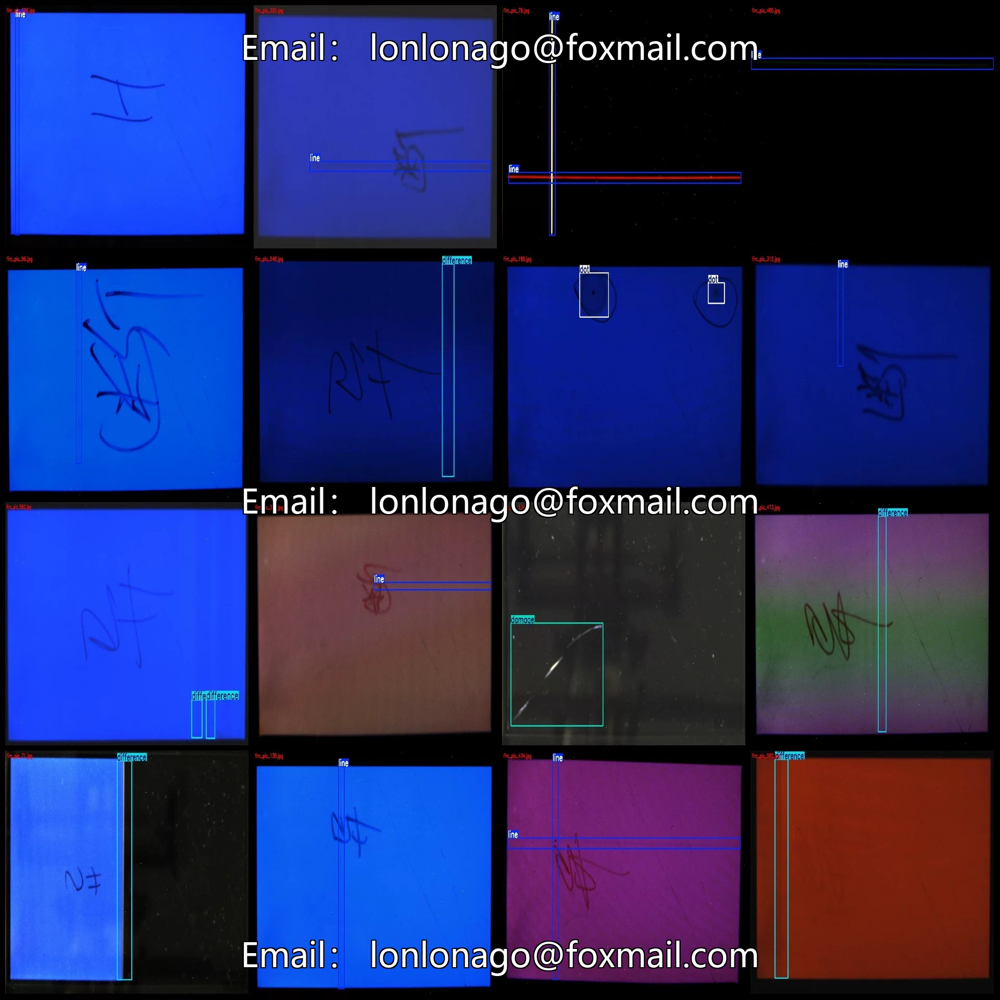
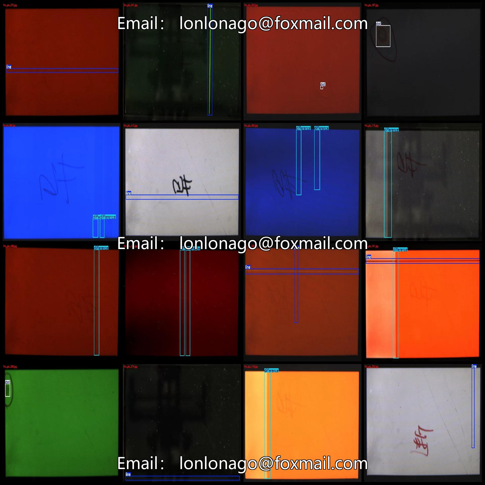
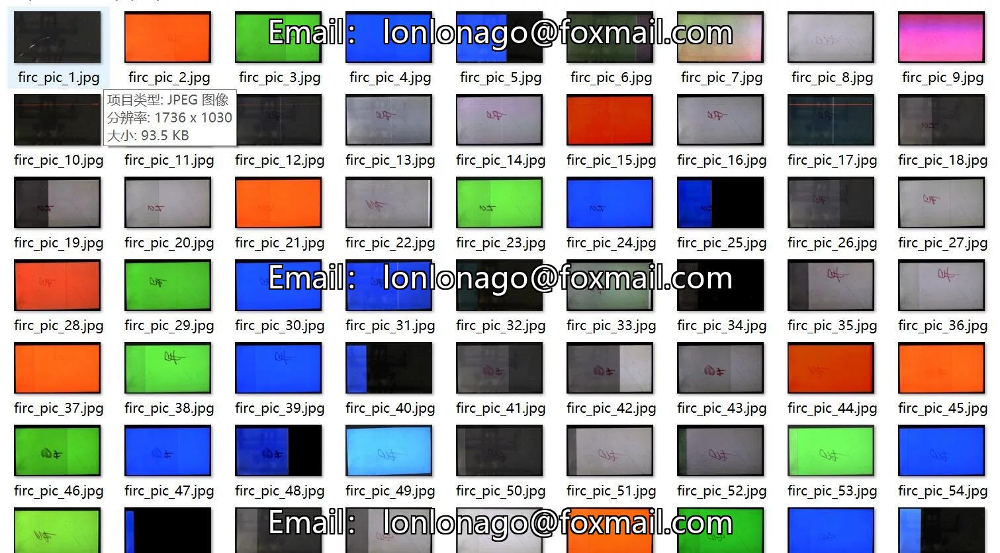
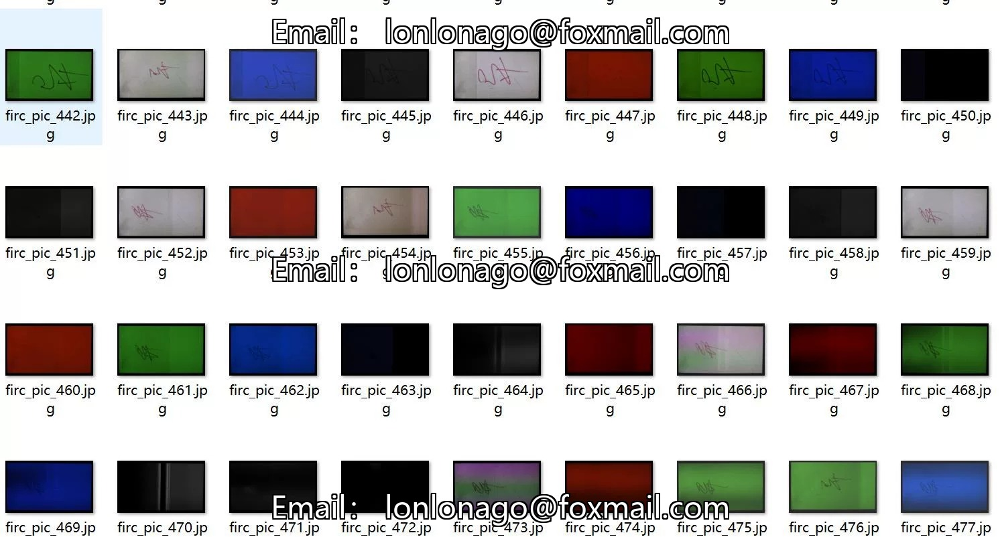
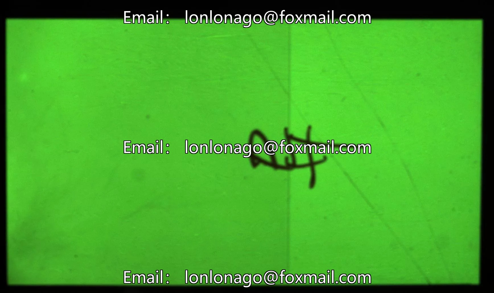
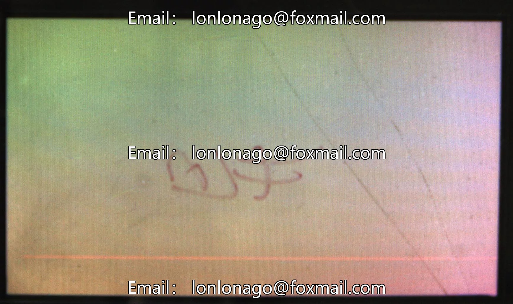
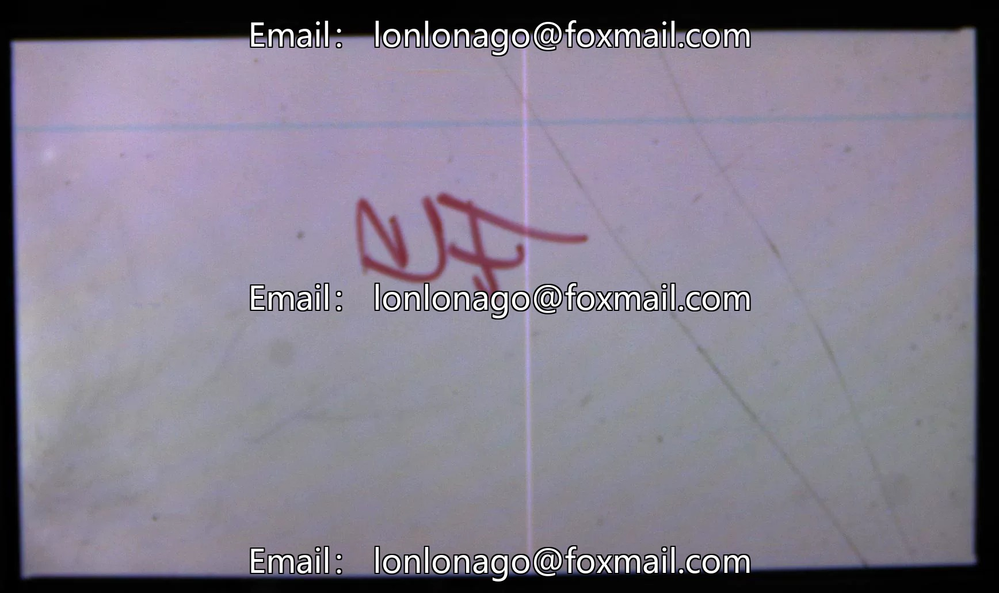

# Industrial Quality Inspection Screen Defect Detection Dataset VOC+YOLO format with 616 images in 4 categories

## Body

Industrial Quality Inspection Screen Defect Detection Dataset - VOC+YOLO format - 616 images in 4 categories
Note: Due to the dataset's replicability, please confirm compliance with requirements before purchasing.
Dataset format: Pascal VOC format + YOLO format (txt file without split paths, only containing jpg images and corresponding VOC format xml files and yolo format txt files)
Number of images (number of jpg files): 616
Number of annotations (number of xml files): 616
Number of annotations (number of txt files): 616
Number of annotation categories: 4

Annotation Category Names (Note that the order of categories in the yolo format does not correspond to this, but is based on the classes.txt file in the labels folder): ["damage", "difference", "dot", "line"]
The number of boxes and images occupied by each category:
- damage (Damage) : Boxes = 16, Images = 16
- difference (Difference) : Boxes = 280, Images = 226
- dot (Dot) : Boxes = 59, Images = 54
- line (Line) : Boxes = 448, Images = 355
Total Boxes: 803
Image Resolution: 1736x1030

Using labeling tool: labelImg
Labeling rules: Draw a rectangle around the category.
Important note: The dataset does not have separate training, validation, and test sets; you need to partition them yourself.
Special statement: This dataset does not guarantee the accuracy of the trained models or weight files.

## Images

## Payment

Here is a pay link on Stripe ( https://buy.stripe.com/3cs8yP7sY87d0vu9AB ). Please contact me lonlonago@foxmail.com after funding $89, and I will send you a complete data files , thank you!

